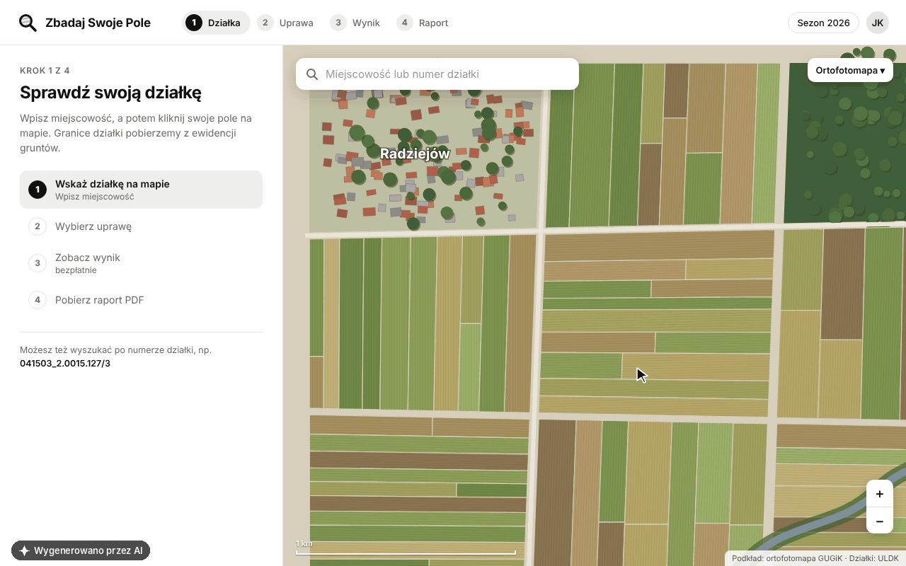

# Zbadaj Swoje Pole

**Raport suszy dla Twojej działki, z danych satelitarnych.**

Rolnik zaznacza pole na mapie, wybiera uprawę i od razu, za darmo, widzi, czy w sezonie były przesłanki, że uprawa ucierpiała przez suszę. Jeśli potrzebuje tego na papierze, pobiera raport PDF, który może pokazać ubezpieczycielowi.

Projekt na **NASA Space Apps Challenge 2026**.

**[Zobacz przykładowy raport (PDF)](https://drive.google.com/file/d/1_YoRySP0AmSlPAFJlIa0qUzT8VSl34LY/view?usp=sharing)**

---

## Problem

W suchych latach 2018–2019 polscy rolnicy tracili przez suszę średnio **8,8 mld zł rocznie**. Wypłacone zostało im w tym czasie za suszę średnio **2,3 mld zł rocznie**. *(NIK, 2022)*

Przy suszy nie ma komisji, która przyjedzie na pole. O tym, czy susza wystąpiła, decyduje model liczony dla całej gminy. Rolnik nie ma żadnego dokumentu o tym, co działo się na jego działce.

## Jak to działa

1. **Wybierz działkę** — kliknij swoje pole na mapie.
2. **Wskaż uprawę** — każda roślina ma inne progi suszy i inne okresy wrażliwości.
3. **Zobacz wynik** — ocena przesłanek: brak sygnału, umiarkowane albo silne. Bezpłatnie.
4. **Pobierz raport** — test ustawowy suszy, kondycja roślin przez cały sezon, wilgotność gleby i źródła danych.

## Dane

Tylko publiczne i bezpłatne źródła, więc każdy może sprawdzić wynik sam: **NASA** (HLS, SMAP), **Copernicus** (Sentinel-1, Sentinel-2), **IUNG-PIB** (System Monitoringu Suszy Rolniczej) i **GUGiK** (granice działek).

Następny krok to **NISAR**: radar, który mierzy wilgotność gleby przez chmury, akurat w tygodniach, w których rośliny są najbardziej wrażliwe.

## Cena

Wynik jest bezpłatny. Raport kosztuje od 2 do 4 zł za hektar, zależnie od wielkości gospodarstwa. Cena nie zależy od wyniku.
